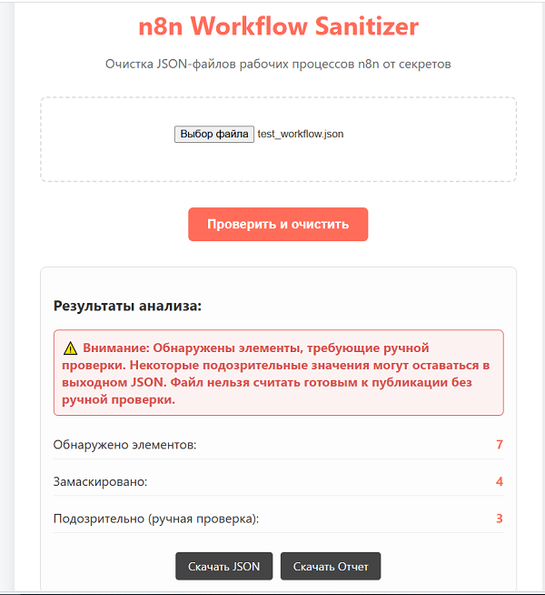
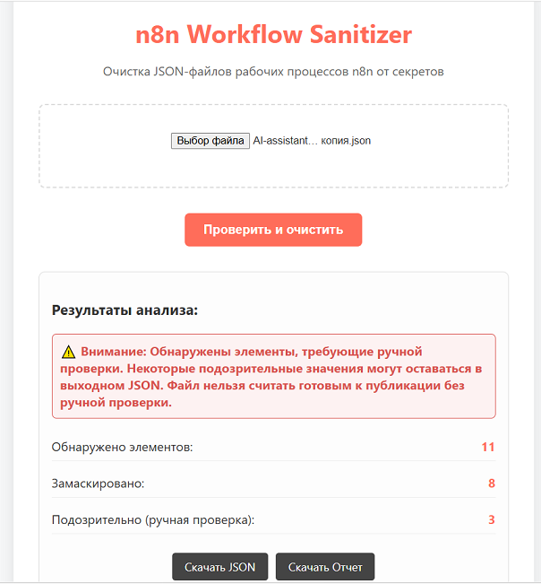

# n8n Workflow Sanitizer

Локальный инструмент для проверки и обезличивания JSON-файлов, экспортированных из n8n, перед публикацией в открытых репозиториях, например на GitHub.

Sanitizer обнаруживает потенциально конфиденциальные данные, маскирует распознанные секреты, проверяет сохранность структуры workflow и формирует отчёт о результатах обработки и рисках, требующих ручной проверки.

## Возможности

- **Локальная обработка** - приложение запускается на компьютере пользователя и обрабатывает загруженный JSON через локальный веб-интерфейс.
- **Маскирование секретов** - поиск и замена распознанных API-ключей, токенов, паролей и других конфиденциальных значений.
- **Обезличивание учётных данных** - очистка идентификаторов и названий объектов `credentials`, а также отдельных инфраструктурных идентификаторов.
- **Анализ вложенных данных** - поиск секретов в JSON-строках и некоторых JavaScript-присваиваниях.
- **Сохранение структуры** - контроль количества нод, соединений и выражений n8n.
- **Отчёт о безопасности** - сведения об автоматически замаскированных значениях, предупреждениях и нерешённых рисках.
- **Веб-интерфейс на русском языке** - загрузка workflow и скачивание результатов обработки.

## Требования

- **Python**. Проверенная версия: 3.13.17.
- **Flask**. Проверенная версия: 3.1.3.
- Веб-браузер.

Совместимость с другими версиями Python и Flask отдельно не подтверждена.

## Установка

1. Клонируйте репозиторий или скачайте файлы проекта.
2. Перейдите в корневую папку проекта.
3. Установите Flask:

```bash
python -m pip install Flask==3.1.3
```

## Запуск

Из корневой папки проекта выполните:

```bash
python app.py
```

Откройте в браузере:

`http://127.0.0.1:5000`

## Использование

1. Экспортируйте нужный workflow из n8n в формате JSON.
2. Запустите n8n Workflow Sanitizer локально.
3. Загрузите JSON-файл через веб-интерфейс.
4. Нажмите «Проверить и очистить».
5. Изучите статистику обработки и обнаруженные риски.
6. Скачайте два файла:
   - `public_<timestamp>.json` - обработанный workflow;
   - `report_<timestamp>.md` - отчёт о маскировании, предупреждениях и нерешённых рисках.
7. Проверьте итоговый JSON и отчёт вручную перед публикацией.

### Важное ограничение: webhookId

Sanitizer сохраняет `webhookId`, чтобы не нарушить совместимость workflow при импорте в n8n.

Обнаруженные `webhookId` отмечаются в отчёте как нерешённые риски публикации.

**Если отчёт содержит нерешённые риски, файл нельзя считать готовым к публичной публикации.** Перед загрузкой на GitHub необходимо вручную устранить или оценить эти риски.

## Ограничения безопасности

- Инструмент не гарантирует обнаружение всех конфиденциальных данных.
- Нестандартные форматы секретов могут остаться незамеченными.
- Приложение выполняет статический анализ и не исполняет JavaScript-код из workflow.
- Локальный запуск сам по себе не является доказательством отсутствия сетевой активности.
- После маскирования учётных данных для повторного использования workflow потребуется заново настроить соответствующие подключения.
- Успешная структурная проверка не гарантирует работоспособность всех интеграций.

**Перед публичной загрузкой всегда проверяйте обработанный JSON и отчёт вручную.**

## Тестирование

Проект содержит автоматические проверки маскирования данных, формирования отчётов и сохранения структуры n8n workflow.

Запуск из корневой папки проекта:

```bash
python -m py_compile app.py
python tests.py
python tests_detailed.py
python test_webhook.py
```

**Результат проверки от 17.11.2026:** все четыре команды завершились успешно.

### Проверка на реальном workflow

Sanitizer дополнительно протестирован на экспортированном workflow AI-ассистента салона красоты.

По результатам обработки:

- Обнаружено 11 элементов, связанных с конфиденциальными данными и рисками публикации.
- Автоматически замаскировано 8 значений.
- Выявлено 3 нерешённых риска, связанных с `webhookId`.
- Сформировано 4 предупреждения об использовании `allowUnauthorizedCerts: true`.

Обработанный JSON успешно импортирован обратно в n8n. Количество и расположение нод, а также соединения визуально сохранились.

После импорта требуется повторная настройка учётных данных.

Эта проверка подтверждает успешный импорт конкретного workflow, но не заменяет функциональное тестирование всех его интеграций.

## Скриншоты

### Обработка тестового workflow



На тестовом JSON обнаружено 7 элементов: 4 автоматически замаскированы, 3 требуют ручной проверки.

### Обработка реального workflow



При обработке реального workflow обнаружено 11 элементов: 8 автоматически замаскированы, 3 требуют ручной проверки.

В обоих случаях приложение предупреждает о необходимости ручной проверки перед публикацией JSON.

## Скилл для Claude Code

Для проекта создан скилл Claude Code, который помогает:

- ориентироваться в структуре репозитория;
- запускать приложение локально;
- вносить изменения в код;
- запускать тесты и диагностировать ошибки;
- поддерживать документацию в актуальном состоянии;
- готовить проект к безопасной публикации.

Скилл доступен в репозитории: [SKILL.md](.claude/skills/n8n-workflow-sanitizer/SKILL.md).

## Статус проекта

**Рабочий MVP.** Основные функции реализованы и проверены локально.

Инструмент предназначен для предварительной очистки и анализа workflow перед публикацией. Окончательное решение о безопасности публикации принимает пользователь после ручной проверки результатов.